# Blind Spot

**AI that widens your thinking without giving you a single idea.**

A collaborative whiteboard for brainstorming. Blind Spot maps your team's ideas onto named lenses, shows the corner nobody has explored, and pins a *question* about it. It never writes an idea for you.

[**Live app**](https://blindspot-sable.vercel.app) · [**90-second tour**](https://blindspot-sable.vercel.app/tour?live=1) · [**Guided demo**](https://blindspot-sable.vercel.app/demo) · [**Sandbox board**](https://blindspot-sable.vercel.app/play) · [How we built it](https://blindspot-sable.vercel.app/why) · [Pitch deck](https://blindspot-sable.vercel.app/pitch)

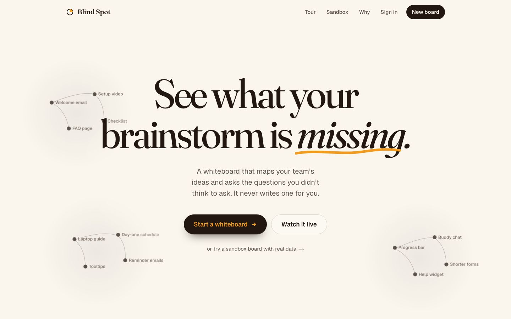

---

## The problem

When a whole room asks the same assistant for ideas, the answers drift toward one safe middle. [Microsoft Research](https://www.microsoft.com/en-us/research/articles/rethinking-ai-in-knowledge-work-from-assistant-to-tool-for-thought/) reports that generative AI narrows the range of ideas knowledge workers produce, and argues AI should be a *tool for thought* that sharpens your thinking rather than an assistant that does it for you.

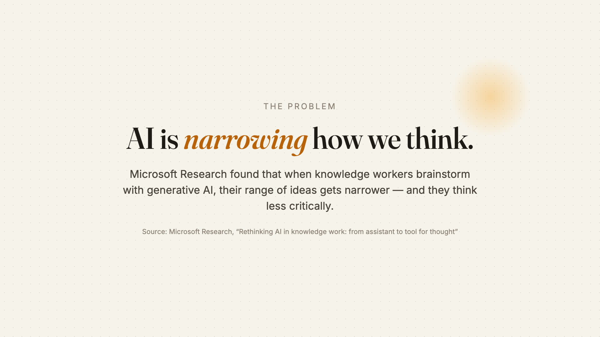

Blind Spot is the opposite of an idea generator: it shows a team where it hasn't looked, and leaves the ideas to the people.

## The one rule

> **The AI asks. It never suggests.**

Models are trained to be helpful, so every early draft slipped into "you could try…". A prompt alone isn't enough, so every question passes four layers before it can reach the board:

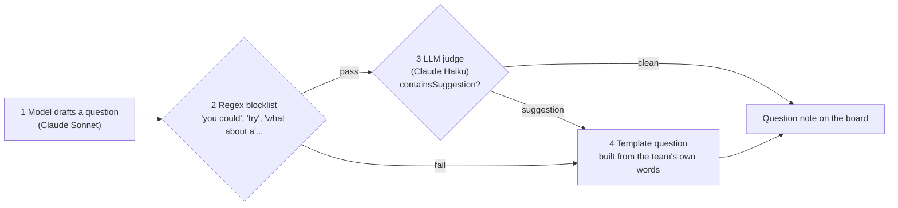

The template fallback is deterministic, so a bad generation can never break the demo or the rule. Our suggestion-guard evals: **20/20** on the original question set and **40/40** after adding the newer question types.

## How it works

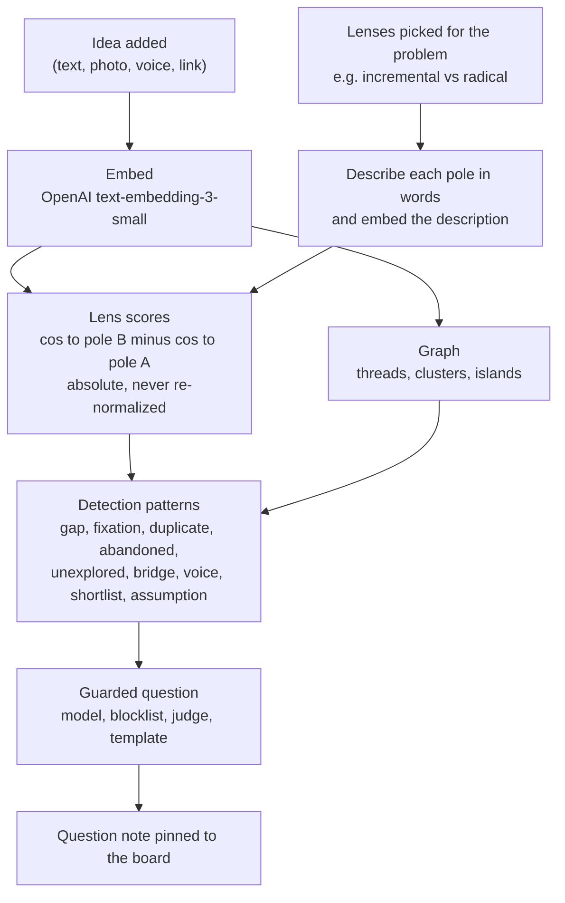

- **Lenses, not clusters.** The AI picks named bipolar axes for your problem (*incremental ↔ radical*, *individual ↔ social*, ...). An empty patch of a UMAP plot can't be named; an axis can. So a gap becomes a sentence: "you never went radical."
- **Scoring by meaning.** Each pole is embedded as a short description of what that end means, not as a bare word, so ideas score by meaning rather than keyword overlap. Scores are absolute: adding an idea never changes existing scores.
- **Detection is pure TypeScript** over in-memory vectors (`src/lib/engine`), so it runs identically live and in the offline demo.

### Adding an idea

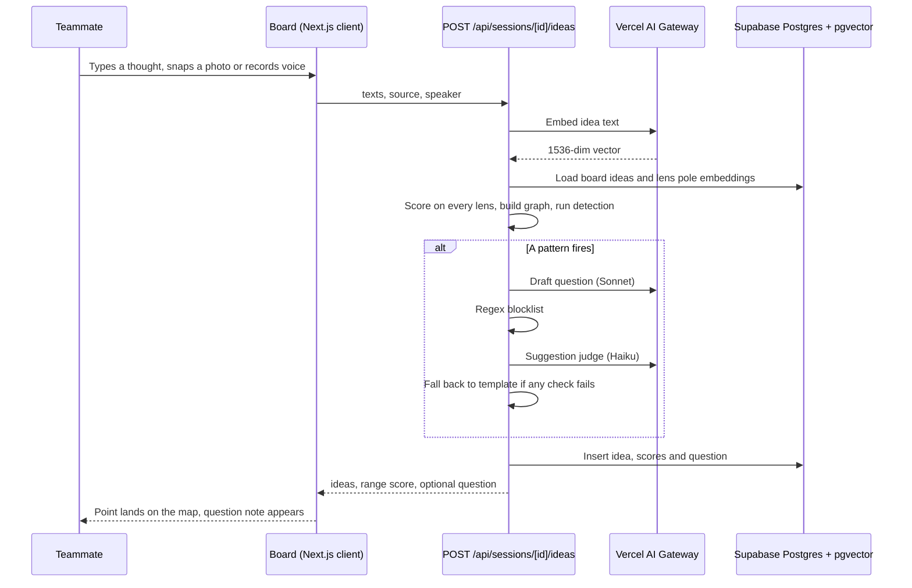

**The thought map.** Every point is an idea a human added. Threads connect related ideas; clusters glow.

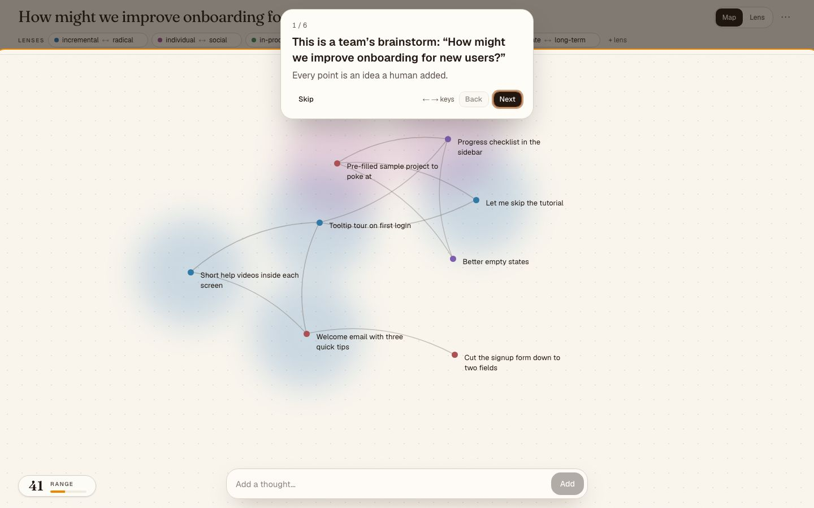

**Lens view.** Flip the board and every point lands on two lenses. The hatched corner is the blind spot: *nobody's been here yet*.

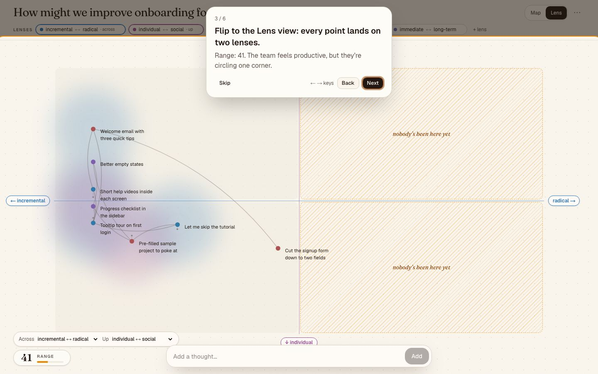

**The question note.** A question about the gap, never an idea, with "Why am I seeing this?" showing the pattern and the ideas behind it.

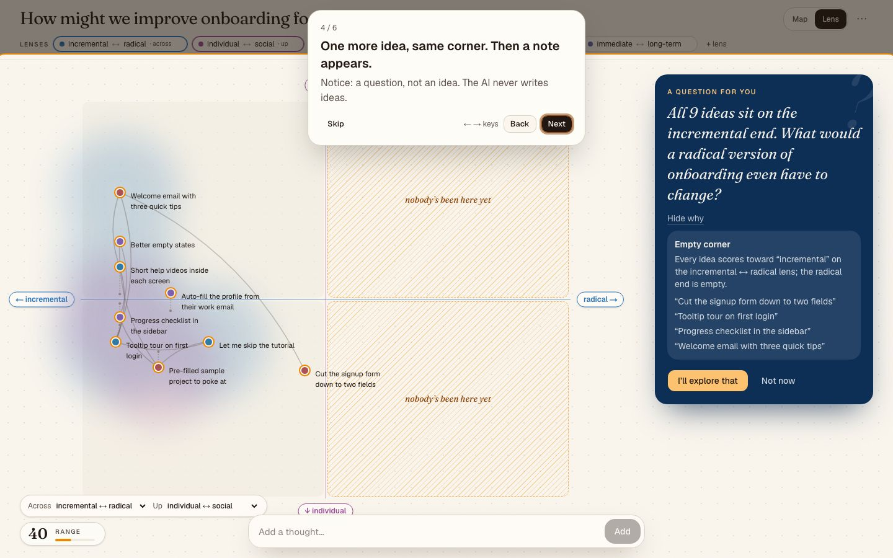

**The ledger.** The thesis as one line.

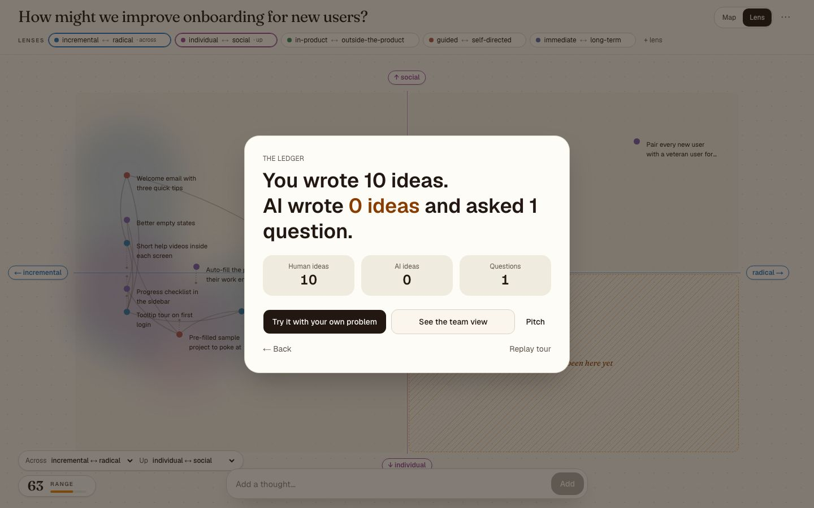

## Features

**Thinking**
- **Lenses** chosen for your problem, editable, with pole descriptions for scoring by meaning
- **Lens view** with any two lenses across and up, and the empty corner hatched
- **Connections:** threads between related ideas, clusters, islands, and links you draw yourself
- **Question types:** gap, fixation, duplicate, abandoned, unexplored lens, bridge, voice, shortlist, assumption
- **Converge:** shortlist ideas and surface the assumptions under them as **assumption cards**
- **Replay** how a board grew, and a share recap
- **Range:** a 0–100 score of how widely the team has explored

**Rich points**
- Text, image, voice and link points
- Point inspector with related ideas and a "why" for each connection
- **Find context (Exa):** web evidence about a point. Evidence, not ideas.

**Teams**
- Accounts, saved boards and **My boards**
- Invite links and author dots on points
- Async **"while you were away"** digest of what changed since you last looked
- Cross-session **insights** (`/insights`): lens heatmap, range trend, question take-rate

**Physical room**
- **Phone join** by QR code (`/join/[id]`): add notes, photos of paper sticky notes, or voice
- **Room camera mode** (`/room/[id]`): watches a physical wall, detects new sticky notes, dedupes them, and holds them in a 5-second review tray
- **Ambient room light** (`/ambient/[id]`): a full-screen glow that shifts from teal to amber as the team's range grows
- **AR view** (`/ar/[id]`): look around the board in 3D (three.js, device orientation or drag)

**Sponsor integrations**
- **Glasser reality check:** shows how crowded a space already is. Evidence, not ideas.
- **Exa:** "Find context" for a point

**Ways in**
- `/tour`: a 16-chapter guided tour, plus `?live=1` which drives the real board against the real API
- `/demo`: an offline guided demo on a seeded board
- `/play`: a sandbox board with real data and no LLM calls

## Architecture

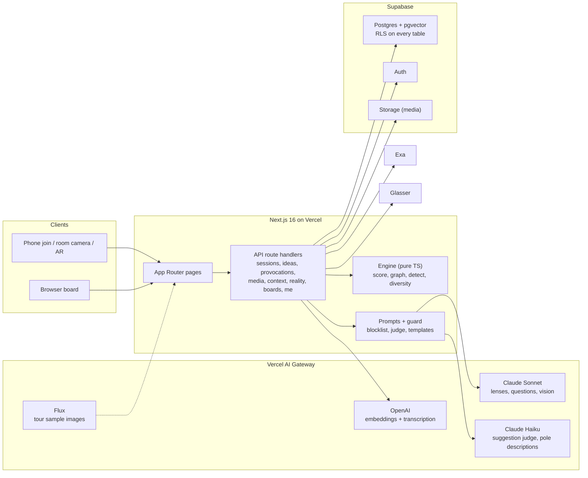

`DEMO_MODE=true` serves a seeded session with cached embeddings and canned questions, so every AI feature has an offline path. Public AI endpoints are rate-limited with body size limits.

## Built with AI, decided by humans

AI wrote most of our code. It couldn't decide what the product is for, who it helps, or what it must never do. The full judgment log is at [`/why`](https://blindspot-sable.vercel.app/why) and in [`docs/JUDGMENT_LOG.md`](docs/JUDGMENT_LOG.md).

| # | Call | AI proposed | We decided |
|---|---|---|---|
| 1 | **The one rule** | Drafts drifted into "you could try…" | A separate checker (blocklist + judge, template fallback) rejects any suggestion |
| 2 | **Lenses over clusters** | Embed, UMAP, show clusters | Named bipolar lenses, so a gap can be said out loud |
| 3 | **Caught a scoring flaw** | Per-session normalization of each lens | We measured raw embeddings, saw it made every lens look balanced and hid every real gap, and switched to absolute scores |
| 4 | **Whiteboard first** | Form, lens review, scatter plot | Rebuilt the UI as a whiteboard, where brainstorms actually happen |
| 5 | **Connections** | Ideas as independent dots | Threads, clusters, islands, links you draw |
| 6 | **Async** | One live session that ends with the tab | Accounts, saved boards, invites, "while you were away" |
| 7 | **Evidence, not ideas** | A reality check that says "here's what others built, try this" | Glasser only shows how crowded a space is |

**How the build was orchestrated.** A Claude Code orchestrator planned the work, froze the API contract first (`src/lib/contract.ts`), and coordinated Codex, Cursor and Claude subagents through agentteams: each agent claimed files, worked a task in its own git worktree and branch, and merged as each slice went green. Playwright end-to-end tests (`tests/e2e`) were the safety net between merges. Humans made the product calls above.

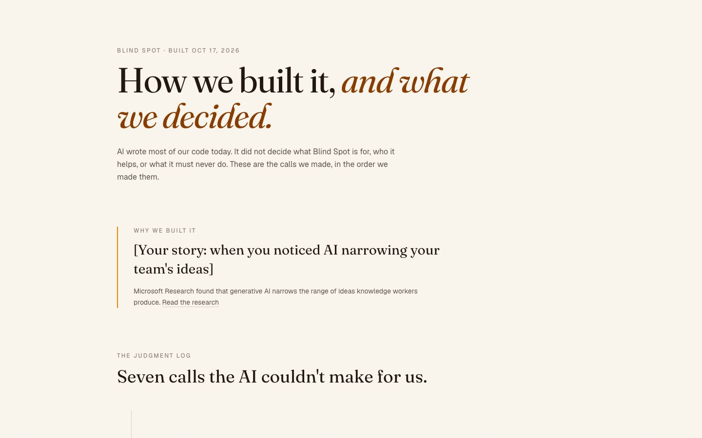

## Tech stack

| Layer | Choice |
|---|---|
| App | Next.js 16 (App Router), React 19, TypeScript, Tailwind CSS v4, motion, three.js |
| AI | Vercel AI Gateway via the AI SDK: Claude Sonnet, Claude Haiku, OpenAI `text-embedding-3-small`, OpenAI transcription |
| Data | Supabase Postgres + pgvector, Supabase Auth, Supabase Storage, row-level security |
| Search | Exa (context), Glasser (reality check) |
| Validation | zod |
| Testing | Playwright e2e, `node:test` for the engine |
| Hosting | Vercel |

## Local setup

```bash
git clone https://github.com/RonKat2008/blindspot.git
cd blindspot
npm install
cp .env.example .env.local   # fill in the names below
npm run dev
```

Environment variables (names only):

| Variable | Purpose |
|---|---|
| `NEXT_PUBLIC_SUPABASE_URL` | Supabase project URL |
| `NEXT_PUBLIC_SUPABASE_PUBLISHABLE_KEY` | Supabase publishable key |
| `VERCEL_OIDC_TOKEN` or `AI_GATEWAY_API_KEY` | Vercel AI Gateway auth (`vercel env pull` provides the OIDC token) |
| `EXA_API_KEY` | Exa "Find context" |
| `GLASSER_API_KEY` | Glasser reality check |
| `DEMO_MODE` | `true` serves the seeded session and canned AI replies |

Apply the schema in `supabase/migrations/` to your Supabase project (`npx supabase db push`).

| Command | What it does |
|---|---|
| `npm run dev` | Dev server |
| `npm run verify` | Typecheck + lint + production build |
| `npm run e2e` | Playwright end-to-end tests |
| `node --test --experimental-strip-types src/lib/engine/` | Engine unit tests |
| `npm run record` | Record the 1080p demo video |

### Project structure

```
src/
├── app/            # pages (/, /demo, /tour, /play, /why, /pitch, /s, /join, /room, /ar, /ambient, /boards, /insights) and api/
├── components/     # board, tour, converge, assumption, replay, share, account, hero, site, ui
├── lib/
│   ├── engine/     # pure TS: score, graph, detect, diversity, project
│   ├── prompts/    # lenses, pole descriptions, questions, guard, templates
│   ├── supabase/   # clients, boards, members
│   └── contract.ts # frozen API contract
└── proxy.ts        # session refresh + rate limits
scripts/            # eval-provocations, seed, smoke, record-demo
supabase/           # migrations
tests/e2e/          # Playwright specs
```

## Screenshots

| Guided tour | Judgment log |
|---|---|
| 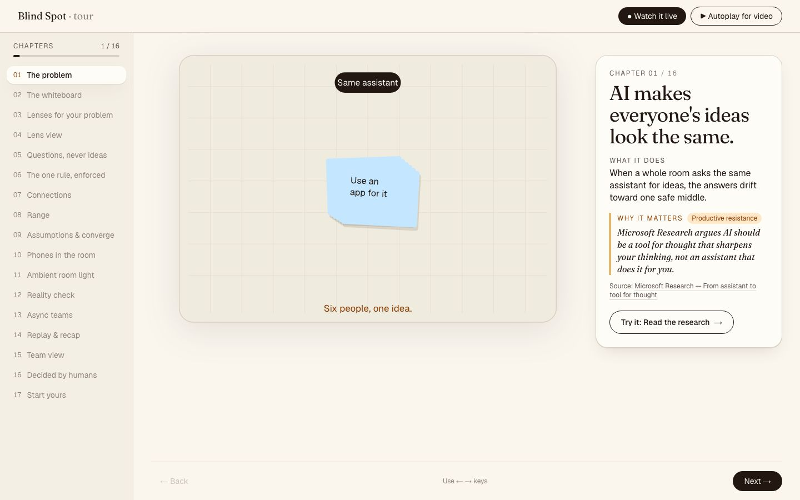 |  |
| **Pitch deck** | **Phone join** |
| 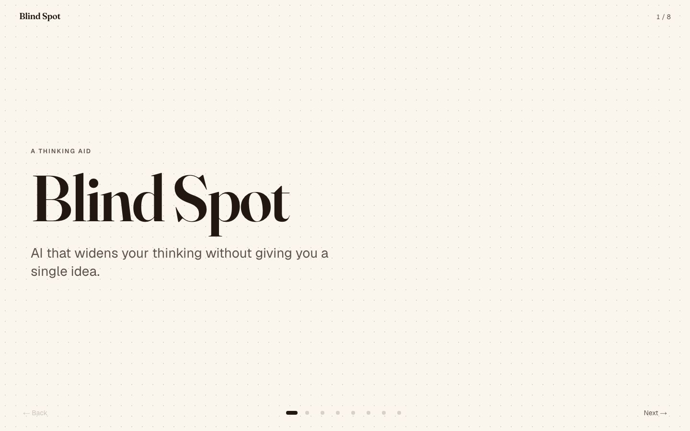 | 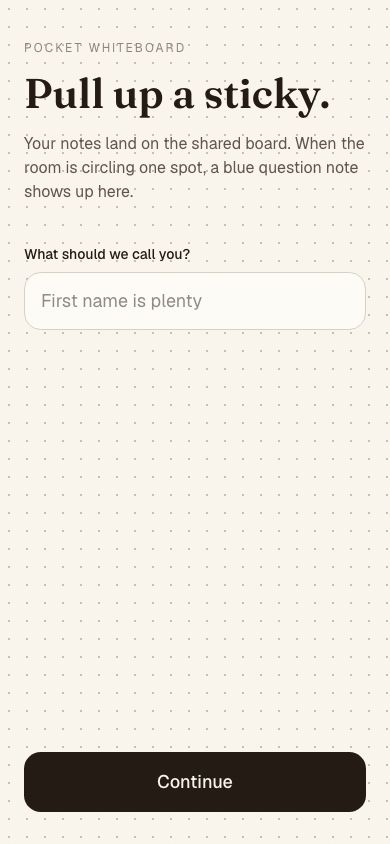 |

## Team

Built at **Code Something AI Cannot Do Alone**, UC Berkeley, Oct 17 2026.

Team: [names]
